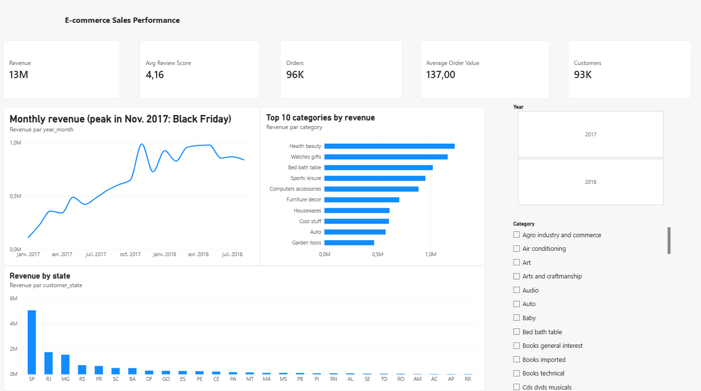
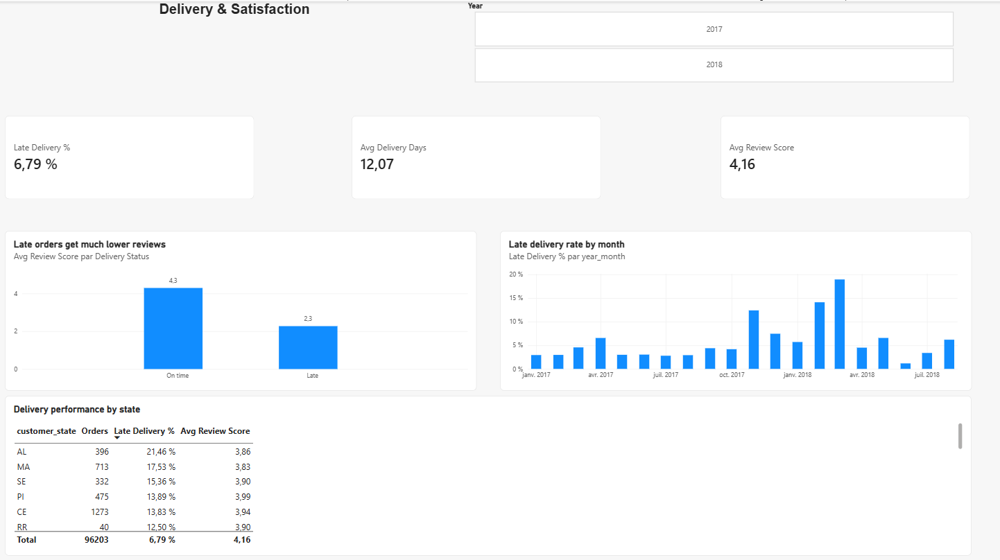

# E-commerce Sales Performance – Power BI Dashboard

An interactive 2-page Power BI dashboard built on **96,203 real orders** from Olist, a Brazilian e-commerce marketplace (2017–2018).





## Business questions

1. How is revenue evolving, and when are the peaks?
2. Which product categories and regions drive sales?
3. How reliable are deliveries, and does it affect customer satisfaction?

## Key insights

- **13.2 M R$ revenue**, 96 K orders, 93 K customers, average order value of **137 R$**.
- Revenue grew steadily through 2017 and peaked in **November 2017 (Black Friday)**.
- **Health & beauty**, **watches & gifts** and **bed, bath & table** are the top categories.
- **São Paulo (SP)** generates about 40 % of revenue.
- **6.8 %** of orders arrive late, with spikes after sales peaks (up to **19 % in March 2018**).
- Late orders get an average review of **2.3 / 5**, versus **4.3 / 5** for on-time orders.
- North-eastern states (AL, MA, SE) suffer the most delays (15–21 %) and the lowest reviews.

**Recommendation:** strengthen logistics capacity before major promotions and in the north-east, as delays directly destroy customer satisfaction.

## Data model

Star schema built in Python (pandas) from the raw Olist tables, then modelled in Power BI:

| Table | Type | Content |
|---|---|---|
| `fact_order_items` | Fact | 109,872 items sold (price, freight) |
| `fact_orders` | Fact | 96,203 delivered orders (delivery time, delay, review score) |
| `dim_product` | Dimension | product categories |
| `dim_customer` | Dimension | customer city and state |
| `dim_date` | Dimension | calendar (marked as date table) |

All relationships are many-to-one with single-direction filtering, which avoids the ambiguous paths created by the 1:1 order/customer link in the source data.

## DAX measures

```DAX
Revenue = SUM ( fact_order_items[price] )
Orders = DISTINCTCOUNT ( fact_order_items[order_id] )
Average Order Value = DIVIDE ( [Revenue], [Orders] )
Customers = CALCULATE ( DISTINCTCOUNT ( dim_customer[customer_unique_id] ), fact_order_items )
Avg Review Score = AVERAGE ( fact_orders[review_score] )
Late Delivery % = DIVIDE ( SUM ( fact_orders[is_late] ), COUNTROWS ( fact_orders ) )
Avg Delivery Days = AVERAGE ( fact_orders[delivery_days] )
Revenue Previous Year = CALCULATE ( [Revenue], SAMEPERIODLASTYEAR ( dim_date[date] ) )
Revenue YoY % = DIVIDE ( [Revenue] - [Revenue Previous Year], [Revenue Previous Year] )
Freight % of Revenue = DIVIDE ( SUM ( fact_order_items[freight_value] ), [Revenue] )
```

## Files

- `ecommerce_sales_dashboard.pbix` – the Power BI report (open with the free Power BI Desktop)
- `data/` – the 5 star-schema CSV files
- `screenshot_page1.png`, `screenshot_page2.png` – report pages

## Source

[Brazilian E-Commerce Public Dataset by Olist](https://www.kaggle.com/datasets/olistbr/brazilian-ecommerce) (Kaggle, CC BY-NC-SA 4.0).

---

**Youssef Achou** – Data Analyst · [Synerbyte](https://synerbyte.eu) · [LinkedIn](https://www.linkedin.com/in/youssef-achou-5218a83b9)
